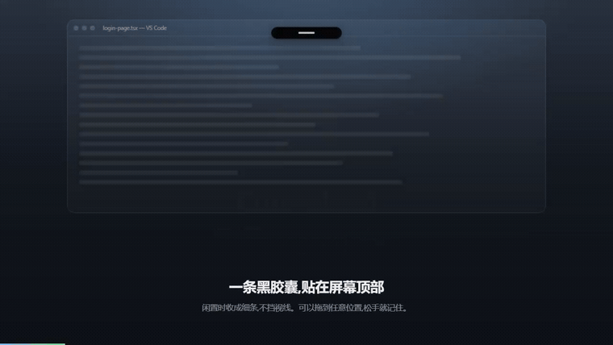

<div align="center">


# Cute Island

**PC 上的灵动岛 — 看住你本机的 AI Agent**

一条黑胶囊贴在屏幕顶部,实时显示 Claude Code、Codex、Gemini、Cursor 正在做什么。<br />
需要审批时主动提醒,人不在电脑前还能从手机接管。

[](https://github.com/xihadance/agent-island/releases)
[](#许可)
[](#安装)
[](https://www.electronjs.org/)

**简体中文** · [English](README.en.md)

<br />

<a href="media/cute-island-intro.mp4">
  
</a>

<sub>▶ [观看完整介绍视频(60 秒)](media/cute-island-intro.mp4)</sub>

</div>

---

## 这是什么

Agent 在后台跑的时候,你没法一直盯着终端。Cute Island 把它们的状态收进屏幕顶部的一条胶囊里:

- **一眼看清进度** — 哪个 Agent、在哪个客户端、跑到第几步、已经花了多久
- **审批不漏接** — 需要你批准或回答时主动展开提醒,不会被普通进度刷新淹没
- **人走了也能处理** — 通过 Telegram、飞书、企业微信、Discord 远程审批、回答和追加指令
- **不打扰** — 闲置收成细条,托管模式下鼠标直接穿透到下面的窗口

## 支持的 Agent

| Agent | 状态识别 | 自动审批 | 远程接管 |
| --- | :---: | :---: | :---: |
| **Claude Code** | ✅ | ✅ HTTP Hook | ✅ 审批 / 回答 / 追加指令 |
| **Codex** | ✅ | ✅ app-server | ✅ 审批 / 回答 |
| **Cursor** | ✅ | — | ✅ Shell / MCP 执行前确认 |
| **Gemini CLI** | ✅ | — | ✅ BeforeTool 确认 |

> 读取日志只能**展示**状态。要回传批准或答案,必须经过上表中的原生交互通道。

## 安装

到 [Releases](https://github.com/xihadance/agent-island/releases) 下载对应平台的安装包:

| 平台 | 包格式 | 应用内更新 |
| --- | --- | :---: |
| Windows | `.exe`(NSIS 安装版) | ✅ |
| macOS | `.dmg` | 手动 |
| Linux | `.AppImage` | ✅ |
| Linux | `.deb` | 由包管理器负责 |

首次启动会打开配置窗口。之后可通过托盘「打开配置…」、双击托盘图标,或 `--settings` 参数再次打开。

## 快速上手

1. **装好就能看** — 启动后自动识别本机已在运行的 Claude Code、Codex、Gemini、Cursor 会话,不需要任何配置
2. **想自动审批** — 「Agent 接入」页点「安装接入」,重开 Agent 会话,再到「自动审批」页开启需要的类型
3. **想远程接管** — 「远程接管」页配置消息渠道(凭据填环境变量名),勾选「远程接管」

```bash
# 开发模式
npm install
npm run dev

# 只看界面,不启动 Electron
npm run dev:web     # http://127.0.0.1:5174
```

需要 Node.js 22.12 或更高版本。

## 两种显示模式

可在配置窗口或托盘右键菜单切换,重启后记住选择。

| | **关注模式**(默认) | **托管模式** |
| --- | --- | --- |
| 平时 | 半透明,悬浮恢复实色 | 淡显(28%),空闲细条 16% |
| 鼠标 | 胶囊接收点击,周围透明区域穿透 | 点击、滚动、拖动全部穿透 |
| 交互 | 悬浮、点击展开、拖动、贴边收纳 | 只有提醒面板接收鼠标 |
| 提醒 | 贴边隐藏时向屏幕内展开 | 主动展开并恢复实色 |

两种模式下,**待审批、明确的用户输入请求、会话或子任务异常**都会主动提醒。点「知道了」、按 `Esc` 或问题恢复后回到原来的位置。提醒不会因客户端、进度或时间刷新反复弹出。

> 普通的「等待中」也可能只是在等 Agent 回复,不会仅凭这个状态弹窗。

## 主要能力

<details>
<summary><b>自动识别本机会话</b> — 不用配置,启动即生效</summary>

<br />

持续跟踪四种 Agent 实际写出的日志:

| Agent | 记录位置 |
| --- | --- |
| Claude Code | `~/.claude/projects/<项目>/<会话>.jsonl` |
| Codex | `~/.codex/sessions/年/月/日/rollout-*.jsonl` |
| Gemini | `~/.gemini/tmp/<项目>/chats/session-*.json` |
| Cursor | `~/.cursor/projects/<项目>/agent-transcripts/<会话>/<会话>.jsonl` |

根目录可用 `CLAUDE_CONFIG_DIR`、`CODEX_HOME`、`GEMINI_CLI_HOME`、`CURSOR_HOME` 覆盖。`CUTE_ISLAND_WATCH=0` 关闭自动识别。

**计时与状态**:执行时间优先取日志里最近一轮用户请求或明确的执行开始事件,中途启动灵动岛也能恢复耗时。等待用户回答或审批的会话不会因日志静默被记成中断。子 Agent 与后台命令在展开后单独列出,各自独立计时。

**识别边界**:除可关联的 Claude 会话外,进程检测只能证明某种 Agent 在运行,无法精确区分该进程下的所有会话。需要精确状态时用下面的 HTTP / CLI 推送。

</details>

<details>
<summary><b>自动审批</b> — 按规则回传批准和选择题答案</summary>

<br />

独立总开关,**默认关闭**。可分别开启权限审批和选择题回答。

- 推荐项支持 `（推荐）`、`(Recommended)` 或原生推荐标记
- 无推荐时默认保留手动回答,也可配置为选择第一项
- **自由输入、密码、重复问题标识、无法确定唯一答案的问题一律保留手动处理**
- 多题请求必须能完整回答才提交

「处理记录」页保留本次启动最近 50 条批准、回答或转交手动的记录,不会把提交答案伪装成工具执行成功。

自动审批与远程接管同时开启时,Claude Code 和 Codex 先按规则处理,无法自动处理的请求才进入灵动岛和远程渠道待办。关闭自动审批或某条规则后,对应请求直接交给你处理。远程入口统一回传结果,避免重复处理。

「自动审批 → 审批黑名单」可设置始终交给你处理的关键词,每行一个,忽略大小写并按包含匹配。例如 `git push`、`.env`、`生产环境`。匹配范围为 Agent 请求中提供的工具名或请求类型、命令、路径、说明及问题内容;命中后不自动批准,也不自动回答选择题。开启远程接管时进入人工待办。点击「保存黑名单」后生效并在重启后保留,清空并保存即可移除限制。已完成的审批不受后续修改影响。

</details>

<details>
<summary><b>远程接管</b> — 从手机处理审批、提问和追加指令</summary>

<br />

支持 **Telegram、飞书、企业微信、Discord**,以及同一 Codex app-server 中已加载的原生线程。

渠道配置包含目标会话或频道、允许操作的用户,以及**凭据的环境变量名称** — 不在表单里填凭据值。缺失的环境变量会按名称提示,设置后重启应用生效。

每项连接保存前可点「测试连通性」:消息渠道发测试消息,Codex 检查服务和已加载线程。

接管服务在跑不代表所有渠道已连通,在渠道中发 `/sessions` 验证。

**能力边界**:

- Claude Code — 权限审批、问题回答、补充指令
- Codex — 通过已配置的 app-server 处理审批和提问
- Cursor — Shell / MCP 执行前确认与后续指导
- Gemini — BeforeTool 确认与上下文指导

Cursor 和 Gemini 的批准只通过本次 Hook 门禁,**原生权限策略仍然生效**,任意原生问答界面不在接管范围。

完整配置见 [远程接管说明](REMOTE_CONTROL.md)。

</details>

<details>
<summary><b>Agent 接入</b> — 安装原生交互通道</summary>

<br />

**Claude Code** — 「Agent 接入」点「安装接入」,重开会话。安装器只增删自己的 HTTP Hook,保留其他配置,修改前创建备份。配置位置 `~/.claude/settings.json`,支持 `CLAUDE_CONFIG_DIR`。需要支持 HTTP Hook 的 Claude Code 版本。

**Codex app-server** — 点「启动托管服务」,灵动岛检测已安装的原生 Codex CLI 并在本机启动服务(默认端口 `4500`)。然后装「命令接入」,重开终端,直接跑 `codex` 即按当前开关自动连接:

```bash
# 也可以手动连接
codex --remote ws://127.0.0.1:4500

# 或自己起服务(客户端必须连到同一个服务)
codex app-server --listen ws://127.0.0.1:4500
```

Windows 接入 PowerShell,macOS / Linux 接入 Bash / Zsh。安装前备份 Shell 配置,移除时保留其他内容。

安装命令接入并启动托管服务后,直接运行 `codex` 使用默认配置,运行 `codex -p agentrouter` 自动读取对应 profile,无需在灵动岛重复填写。支持 `--profile agentrouter`、`--profile=agentrouter` 和 `codex -p agentrouter resume <会话ID>`。先退出原会话客户端再恢复,已运行的独立会话不会自动迁入。

服务自动读取终端的 `$CODEX_HOME/<名称>.config.toml`（新版）或 `config.toml` 的 `[profiles.<名称>]`（旧版）,并使用终端的工作目录和环境变量。profile 仍作为原生 `-c` 服务启动参数应用,优先于项目配置;命令中的显式 `-c` 覆盖 profile。相同配置复用实例;不同 profile、工作目录、环境或配置内容使用独立实例,配置更新后下次运行命令即可生效,已有会话不受影响。原配置不改写,终端环境只在本机内存中传递,不写入设置或日志。停止托管服务或退出灵动岛会关闭全部实例。外部 app-server 无法自动加载 profile 时保留原命令启动并提示原因。

灵动岛作为另一个协议客户端,**只加入服务已加载的会话**,不启动任务,也不修改会话原有的沙箱或审批策略。仅支持本机无认证的 `ws://` 服务。

**Cursor / Gemini** — 在「远程接管 → Agent Hook 接管」安装。安装前备份原配置,保留其他 Hook,同一远程配置的旧版 Hook 会自动迁移。

> 启动脚本使用内附 Electron 的 Node 运行时,**无须另装 Node**。安装后需重开客户端或会话。

</details>

<details>
<summary><b>HTTP / CLI 推送</b> — 把自己的状态送进灵动岛</summary>

<br />

应用只监听 `127.0.0.1:17321`,端口用 `CUTE_ISLAND_PORT` 改。设置了 `CUTE_ISLAND_TOKEN` 时请求要带 `Authorization: Bearer <token>` 或 `X-Island-Token`。

```bash
npm run island -- push --agent Cursor --state running --title "正在修改登录页" --progress 0.4
npm run island -- push --id task-1 --agent Codex --state approval --title "安装依赖" \
  --command "npm install" --shell PowerShell --cwd "D:/projects/app"
npm run island -- end --result success --summary "登录页已更新"
npm run island -- demo
```

```bash
curl -X POST http://127.0.0.1:17321/v1/activities \
  -H 'content-type: application/json' \
  -d '{"id":"run-1","agent":"Cursor","state":"running","title":"正在修改登录页","progress":0.4}'
```

`state` 可以是 `thinking`、`running`、`waiting`、`approval`、`success`、`error`。同一个 `id` 再次 POST 会合并更新。

| 接口 | 说明 |
| --- | --- |
| `POST /v1/activities` | 新增或更新活动 |
| `POST /v1/activities/<id>/end` | 结束活动 |
| `GET /v1/activities` | 返回当前活动 |
| `WS /v1/events` | 每次变化推送 `{ "type": "activities", "activities": [...] }` |

`operation: { kind, name?, command?, shell?, cwd? }` 的 `kind` 支持 `command`、`read`、`edit`、`search`、`mcp`、`skill`、`agent`、`tool`。另可传 `client`、`startedAt`、`endedAt`、`tasks`、`stale`。

</details>

<details>
<summary><b>代理与更新</b></summary>

<br />

**代理** — 「远程接管 → 灵动岛全局代理」默认跟随系统代理。每个消息渠道和远程 Codex 连接也可独立选择直连、系统代理或 HTTP / HTTPS / SOCKS5 代理。连通性测试和正式收发使用同一配置,本机连接始终直连。

**更新** — 「常规 → 版本与更新」默认每天向 GitHub 查询一次版本号,**只读取版本信息,不上传任何本机内容**。有更高版本时显示版本号、发布日期和版本说明,可跳过该版本。

Windows 安装版和 Linux AppImage 支持应用内下载并安装,可选择立即重启安装或下次退出时自动安装。有待处理的远程请求、等待审批或回答的会话、或正在执行的会话时会暂缓立即安装并说明原因。

开发模式不检查更新。`CUTE_ISLAND_UPDATE=0` 优先于界面开关,`CUTE_ISLAND_UPDATE_FEED` 可指向自建版本源。应用更新不占用会话提醒,也不发送到消息渠道。

</details>

<details>
<summary><b>异常会话续接</b></summary>

<br />

Codex 与 Claude Code 主会话明确异常中断时,远程通知提供「继续会话」和「知道了」。

继续操作使用原生会话 ID,核对原生状态后恢复执行并提交继续指令,也支持 `/resume 异常请求ID [继续指令]`。

- **Codex** — 通过已配置且运行中的 app-server 恢复原线程
- **Claude Code** — 在原工作目录后台延续同一会话,保留 Hook 权限门禁。原终端不会同步显示,请在灵动岛查看进度;后台执行结束后可用 `claude --resume 原生ID` 查看会话

重复点击和重启不重放操作。日志静默及子任务异常不会自动启动主会话。关闭接管会停止应用启动的恢复进程。

</details>

## 配置

设置自动保存到 Electron 用户数据目录的 `preferences.json`,与托盘实时同步。窗口位置保存在 `window-position.json`。

| 配置页 | 内容 |
| --- | --- |
| **常规** | 主题(浅色 / 深色 / 跟随系统)、显示模式、会话识别、开机自动启动、恢复位置、版本与更新 |
| **自动审批** | 总开关、权限审批、选择题回答、无推荐时的策略、审批黑名单 |
| **Agent 接入** | 安装状态、Codex app-server、命令接入 |
| **远程接管** | 消息渠道、Codex 连接、Agent Hook、全局代理 |
| **处理记录** | 最近 50 条批准 / 回答 / 转交手动 |

## 开发

```bash
npm install
npm run dev          # Electron 开发模式
npm run dev:web      # 只跑渲染层,浏览器预览
npm test             # vitest
npm run typecheck    # tsc --noEmit
npm run dist         # 类型检查 + 测试 + 构建 + 当前平台打包 → release/
npm run pack         # 只生成可运行目录
```

打包配置已写好 Windows NSIS、macOS dmg、Linux AppImage 和 deb,三端都用 `build/icon.png`。产物同时生成 `latest*.yml` 和 `*.blockmap` — 应用内更新依赖这些文件随 Release 一起发布。

集成验证:

```bash
node scripts/smoke-packaged.cjs "release/win-unpacked/Cute Island.exe"   # 打包后验证
npm run build && node scripts/smoke-interaction.cjs                      # 拖动与透明度
```

两个脚本都使用隔离的临时用户目录和端口,不安装应用、不移动你的鼠标。截图分别存入 `release/` 和 `output/playwright/`。

发布前同步更新 `package.json`、`package-lock.json` 和 `RELEASE_NOTES.md`,然后推送版本标签:

```bash
git tag v0.1.17 && git push origin v0.1.17
```

## 技术栈

Electron · React 19 · TypeScript · Vite · framer-motion · vitest

窗口无边框、透明、置顶,不进任务栏也不抢焦点。macOS 使用 panel 并在全屏空间保持可见,Windows 和 Linux 使用 screen-saver 级别置顶。Linux 需要桌面合成器才能透出后面的内容。

## 文档

- [PRODUCT.md](PRODUCT.md) — 产品定义与能力边界
- [DESIGN.md](DESIGN.md) — 设计说明
- [REMOTE_CONTROL.md](REMOTE_CONTROL.md) — 远程接管完整配置
- [RELEASE_NOTES.md](RELEASE_NOTES.md) — 版本说明

## 许可

MIT
